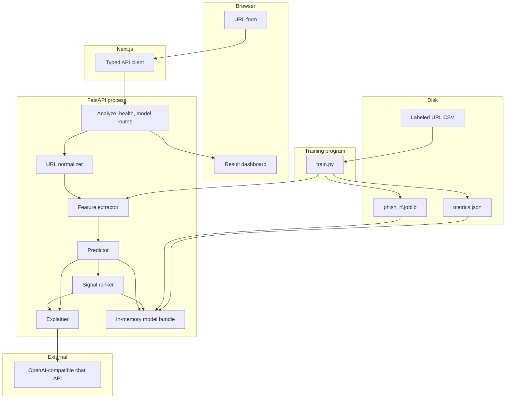
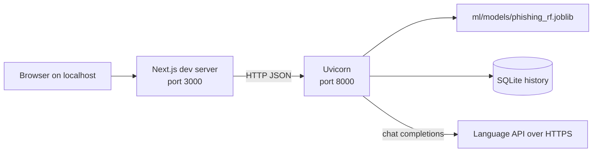

# IntelliShield — High-Level Design

## Problem statement

People receive links that imitate banks, email providers, shipping companies, and login pages. Reading the raw URL carefully catches some of these attacks, and most people do not do that consistently.

IntelliShield is a single-URL checker. It measures structural properties of the link, scores those properties with a Random Forest trained on a public labeled URL dataset, and explains the score in ordinary language. The explanation is tied to the model's output so the narrative cannot quietly become a second, unmeasured classifier.

## Goals

- Accept one URL and return a phishing-versus-legitimate decision with class probabilities.
- Use one feature function for training and for live requests.
- Show the measurements and the signals that align with the predicted class.
- Generate a short threat explanation and defensive recommendations with an OpenAI-compatible LLM.
- Present the result in a dashboard a reviewer can click through.
- Keep each module small enough to walk through in an interview.
- Record real evaluation metrics only after training, in a file produced by the training program.

## Non-goals

- Detecting phishing from page HTML, screenshots, logos, or form fields.
- Crawling the submitted URL, following redirects, or resolving DNS.
- WHOIS, certificate transparency, Safe Browsing, or PhishTank lookups at request time.
- User accounts, alerting, or a browser extension.
- Email or attachment analysis.
- Claiming a production false-positive rate before we have measured one.
- Training a deep learning model, or letting the LLM cast the verdict.
- Multi-tenant isolation, billing, or a public anonymous deployment in v1.

## Functional requirements

| ID | Requirement |
|----|-------------|
| FR-1 | The UI accepts a URL string and submits it to the API. |
| FR-2 | The API rejects URLs that fail the normalization rules in `WORKFLOW.md` with a field-level error message. |
| FR-3 | The API extracts the 16 features in `FEATURE_ENGINEERING.md` in that order. |
| FR-4 | The API returns `legitimate` or `phishing`, `phishing_probability`, and `legitimate_probability`. |
| FR-5 | The API returns every feature name and value. |
| FR-6 | The API returns up to five signals whose median-direction matches the predicted class, ordered by global feature importance. |
| FR-7 | The API returns `analysis` with `summary`, `reasoning`, `risk_factors`, and `recommendations`, separate from `prediction`. |
| FR-8 | When the LLM call is unconfigured or fails, `analysis.source` is `fallback` and `prediction` is unchanged. |
| FR-9 | The UI maps `legitimate` to the banner word Safe and `phishing` to Phishing, and shows the probability, signals, features, and explanation together. |
| FR-10 | Health and model endpoints report whether the bundle loaded and which artifact id is active. |

## Non-functional requirements

| ID | Requirement |
|----|-------------|
| NFR-1 | A local analyze request, excluding the LLM, should complete well under a second on a developer Mac. The forest scores one row. |
| NFR-2 | The LLM call has a hard timeout of 20 seconds. The HTTP handler does not wait longer than that. |
| NFR-3 | The feature extractor is deterministic and side-effect free. |
| NFR-4 | Secrets (API key, base URL) live in environment variables, never in the repository. |
| NFR-5 | Submitted URLs are not written to an application log line. The history row stores the URL after userinfo and query values are replaced with `REDACTED`. Those same fields are redacted before the LLM request. |
| NFR-6 | The model artifact records the dataset DOI, the feature-name list, the split seed, and the metrics computed on the held-out test set. |
| NFR-7 | The first version runs as two local processes: Next.js and Uvicorn. |
| NFR-8 | Python dependencies and Node dependencies are pinned when the projects are scaffolded, in their respective lockfiles. |

## System architecture

IntelliShield is a two-tier web application plus one outbound HTTPS call.

- **Presentation.** Next.js, TypeScript, Tailwind CSS. Renders the form and the dashboard. Holds no model.
- **Application API.** FastAPI. Owns validation, features, inference, signal ranking, and the LLM client.
- **Model artifact.** A joblib file on the API host's disk, loaded into memory at process start.
- **Language API.** Any chat-completions endpoint that speaks the OpenAI-compatible protocol. The vendor is selected with `OPENAI_BASE_URL` and `OPENAI_MODEL`.

Training is an offline program, not a request path. It reads the dataset from `data/`, writes the bundle into `backend/models/`, and exits.

## Component diagram



## Data flow

1. Offline, once: CSV URL column → shared extractor → matrix of 16 columns → stratified split → forest fit on the training fold only → evaluation on the untouched test fold → joblib bundle and `metrics.json`.
2. Online, per request: raw string → normalized URL → same extractor → one row → `predict_proba` → signal list → redacted explanation payload → combined JSON → the Next.js dashboard. The explanation payload cannot change the forest label.

The test fold is not used to choose hyperparameters. Hyperparameters are chosen by stratified cross-validation inside the training portion. Details are in `ML_PIPELINE.md`.

## Frontend architecture

The dashboard is a Next.js App Router page in `frontend/`. It holds no model and no language-model key. The browser calls `POST /api/v1/predict` on `NEXT_PUBLIC_API_BASE_URL` (default `http://localhost:8000`).

```text
frontend/
├── app/page.tsx                 navigation, form, empty, loading, error, and result states
├── components/URLInput.tsx
├── components/AnalysisResult.tsx
├── components/RiskBadge.tsx
├── components/ConfidenceIndicator.tsx
├── components/ThreatSignals.tsx
├── components/ModelInformation.tsx
├── components/ThreatAnalysis.tsx
├── components/Recommendations.tsx
├── components/LoadingState.tsx
├── components/ErrorState.tsx
├── components/StatusIndicator.tsx  GET /health, model loaded or not
├── components/HistoryList.tsx      recent rows; choosing one loads GET /api/v1/history/{id}
├── hooks/useAnalyzeUrl.ts          request state for one submission
├── hooks/useHistory.ts             list and open a saved analysis
├── lib/api.ts                      fetch, error parsing, response check
├── lib/format.ts                   labels and number formatting
└── types/predict.ts                the FastAPI response
```

`app/page.tsx` starts empty. It does not render a sample verdict. While the request is in flight it shows `LoadingState` and clears the previous result. `ErrorState` shows the API `error.message` for 422, 500, and 503, or a network message when the service cannot be reached. A body that is not the predict schema is an error, not a guessed score.

`HistoryList` loads `GET /api/v1/history` and shows the stored time, prediction, risk level, probability, and redacted URL. Choosing a row loads `GET /api/v1/history/{id}` and renders that saved body with `AnalysisResult`. It does not score the URL again.

`AnalysisResult` renders only a checked `PredictResponse`:

- `prediction` as SAFE or PHISHING. `safe` is the API name for the forest's legitimate label.
- `risk_level` as LOW, MEDIUM, or HIGH through `RiskBadge`.
- `probability` as a percentage with one decimal place. That number is the probability of the returned label, not always the phishing-class probability. The meter width is that same value.
- `signals` and `features` in `ThreatSignals`. `uses_https` displays Enabled or Not used. Other binary measurements display Yes or No from the returned 0 or 1. The assessment column is `signal.summary`. Missing keys are omitted.
- `analysis` in `ThreatAnalysis` and `Recommendations`. `source` is shown as either a language-model explanation or the fallback text. Neither one is used as the verdict. `ModelInformation` shows the classifier name Random Forest, the returned prediction, the returned confidence, and the count of feature keys in that response.

Styling is Tailwind only. The console is a light analysis layout: charcoal text, a deep blue action, restrained green for SAFE, restrained red for PHISHING, and amber when the model is not loaded. Monospace is used for the URL and measured values. The probability bar is a styled div. `StatusIndicator` reads `GET /health`. Manual deployment steps are in `DEPLOYMENT.md`.

The browser never receives the API key. LLM calls stay on the server.

## Backend architecture

```text
HTTP route  →  Pydantic schema  →  service functions  →  response schema
```

| Module | Responsibility |
|--------|----------------|
| `api/routes/analyze.py` | Orchestrates one request. Contains no feature math. |
| `api/routes/health.py` | Liveness and model-loaded flag. |
| `api/routes/model.py` | Public metadata: artifact id, feature names, trained-at timestamp. Omits medians and the estimator. |
| `services/url_normalizer.py` | Rules in `WORKFLOW.md`. |
| `services/feature_extractor.py` | The 16 formulas. Shared with training. |
| `services/predictor.py` | Loads the bundle once. Exposes `predict_one`. |
| `services/signal_ranker.py` | Median comparison and top-five selection. |
| `backend/app/services/llm_service.py` | LLM client, JSON check, fallback text. Does not return a label. |
| `ml/train.py` | Offline training only. |
| `core/config.py` | Reads environment variables with defaults for local development. |

Services return plain Python objects or Pydantic models. Routes convert failures into HTTP errors. This keeps the interview walkthrough linear: route, normalize, features, forest, signals, explain.

## ML architecture

- **Unit of prediction:** one URL.
- **Features:** 16 numeric lexical measurements. No text vectorizer and no byte n-grams in v1, so the dashboard can name every input.
- **Estimator:** `sklearn.ensemble.RandomForestClassifier`.
- **Target:** `1` phishing, `0` legitimate, mapped from the dataset `status` strings.
- **Why a forest:** axis-aligned splits handle 0/1 flags and heavy-tailed counts together; feature scaling is unnecessary; `feature_importances_` is a built-in global summary; inference on one row is cheap.
- **Persistence:** joblib dump of a dictionary, not a bare estimator, so feature order and medians travel with the trees.
- **Explanation layer:** separate from the estimator. See D10 in `PROJECT_OVERVIEW.md`.

The training program refuses to start if the loaded CSV does not contain `url` and `status`, or if `status` contains values other than `legitimate` and `phishing`. It prints the row count and class counts it actually observed. Those counts are copied into the bundle metadata. The publisher's description says 11,430 rows and a 50/50 split; the training log is the check.

## LLM architecture

The explainer is `backend/app/services/llm_service.py`. It runs after `prediction_service.score` already has the forest label. It is a client of a chat-completions API:

- `POST {OPENAI_BASE_URL}/chat/completions`
- Model name from `OPENAI_MODEL`
- Bearer token from `OPENAI_API_KEY`

The prompt carries a closed set of facts: the API prediction (`safe` or `phishing`), the probability of that label, the risk level, the signal sentences, and the normalized URL after userinfo and query values are replaced. The full feature dictionary is not sent. The system prompt states that the classifier prediction is final, that the URL is untrusted data, and that the reply must be one JSON object with `summary`, `reasoning`, `risk_factors`, and `recommendations`. Temperature is `0.2`. The server-side timeout is `LLM_TIMEOUT_SECONDS`, default 20. One attempt, no retry loop.

The server validates that JSON and drops every other field. A label inside the chat response is not copied onto `prediction`. `analysis.source` is `llm` only after validation succeeds.

The fallback is part of the architecture, not an error page. An empty key, a timeout, an HTTP error, or an invalid body still returns the forest verdict. `analysis.source` is then `fallback`, and the sentences are built from the label and the signal summaries.

## Storage

Successful scores are stored in SQLite through SQLAlchemy. The file defaults to `backend/data/intellishield.db`. `DATABASE_URL` replaces it.

```text
backend/app/database/     engine and session factory
backend/app/models/       AnalysisRecord
backend/app/repositories/ save, list recent, get by id
```

The table keeps the classifier fields needed to show the row again: time, redacted URL, prediction, probability, risk level, features, signals, and the explanation. It does not keep the raw query string, userinfo, client address, or API key. Rejected URLs are not inserted. The warmup request is not inserted.

`GET /api/v1/history` returns the newest rows, 20 by default and at most 50. `GET /api/v1/history/{id}` returns one stored score. A missing id is 404.

## API layer

JSON over HTTP, versioned under `/api/v1`. Contracts, status codes, and examples are in `API_SPECIFICATION.md`.

CORS allows the frontend origin from `CORS_ORIGINS`. Methods are `GET` and `POST`. Credentials are not used, because there is no cookie session.

## Error handling

| Layer | Behavior |
|-------|----------|
| Validation | 422 with `error.code = validation_error` and a human message. No partial score. |
| Model load | Process starts, health reports `model_loaded: false`, analyze returns 503. A missing model does not crash import of the feature tests. |
| Feature/model bug | 500 with `error.code = internal_error`. The message is generic. The exception is logged without the raw URL. |
| LLM failure | Swallowed inside `llm_service.explain`. The HTTP status stays 200. `analysis.source` is `fallback`. `prediction` is unchanged. |
| Upstream LLM content that is not the schema | Treated as LLM failure. The unparsed text is not forwarded to the client. |

Error bodies use one schema so the frontend has a single error renderer.

## Security considerations

- **SSRF.** The API does not request the user-supplied URL. Normalization is string processing.
- **Secrets in URLs.** Query values and userinfo are redacted in the LLM payload and in the SQLite row. Application logs omit the URL. The predict response still echoes the normalized URL to the user who just submitted it. History responses use the redacted copy.
- **Prompt injection.** A URL can contain text that tries to instruct the LLM. The system prompt states that the URL is untrusted data, that the verdict is already decided, and that the model must return only the explanation schema. The server discards any response that is not that schema. This reduces the impact; it does not make prompt injection impossible.
- **The LLM is not an authority.** `prediction` is the forest label. `analysis` is a narrative about that label. The server does not parse the summary to change the label.
- **API key placement.** The key is read only inside the FastAPI process.
- **Dependency risk.** joblib loads only the file path configured by `MODEL_PATH`, which defaults to the project bundle. The API does not accept an uploaded model.
- **Abuse of the LLM budget.** `POST /api/v1/predict` and `GET /api/v1/history` are limited to 60 requests per 60 seconds per direct client address. The limit is in-memory and does not trust `X-Forwarded-For`. Health checks are not limited. A reverse proxy in front of this process still needs its own limit.
- **Dataset license.** The training data is CC BY 4.0. The README, written with the code, will carry the Hannousse & Yahiouche citation.

Defensive recommendations produced for the user stay at the level of "do not enter credentials, open the site from a known bookmark, report the message." The explainer prompt forbids evasion advice and exploit steps.

## Scalability considerations

v1 is one Uvicorn worker and one in-memory forest. That fits a portfolio demo and a single reviewer.

The request is stateless aside from the loaded bundle, so a later deployment can run more workers by giving each worker the same joblib file. There is no session to stick to a node.

The expensive and variable part is the LLM round trip, not the forest. If request volume grew, the first split would be a timeout and a pool around the explainer, still returning the template when the language API is saturated. Caching explanations by normalized URL would be a product decision because URLs can be sensitive; it is not in v1.

Training cost is a single forest on about ten thousand rows and 16 columns. It is a laptop job. Retraining is manual.

## Deployment architecture

Local macOS, the target of the first implementation:



Environment variables for the API:

| Variable | Purpose |
|----------|---------|
| `MODEL_PATH` | Path to the joblib bundle. |
| `CORS_ORIGINS` | Frontend origin, default `http://localhost:3000`. |
| `OPENAI_BASE_URL` | OpenAI-compatible origin, no trailing path. |
| `OPENAI_API_KEY` | Bearer token. Empty skips the LLM and sets `analysis.source` to `fallback`. |
| `OPENAI_MODEL` | Model name sent in the chat request. |
| `LLM_TIMEOUT_SECONDS` | Default `20`. |
| `DATABASE_URL` | SQLAlchemy URL. Empty uses the local SQLite file. |

The frontend variable `NEXT_PUBLIC_API_BASE_URL` defaults to `http://localhost:8000`.

A later hosted layout is the same picture with the Next.js app and the API as two services, and the joblib file baked into the API image. No managed database is required. Hosting choices are deferred until the local demo works.

## Technology choices and rationale

| Choice | Rationale |
|--------|-----------|
| Next.js + TypeScript | Requested stack. App Router and typed fetch keep the dashboard contract honest. |
| Tailwind CSS | Fast, consistent layout without a component-library abstraction to explain. |
| FastAPI | Requested stack. Pydantic models are the API spec in code. |
| scikit-learn Random Forest | Requested stack. Appropriate for a small tabular lexical feature set. |
| Pandas + NumPy | CSV load, the feature matrix, medians, and metrics tables. |
| joblib | Requested persistence format. Standard for scikit-learn estimators. |
| OpenAI-compatible HTTP API | Works with OpenAI and with compatible local or hosted endpoints by changing the base URL. |
| SQLite + SQLAlchemy | One local file is enough to reopen a score. Query values and userinfo are removed before insert. |
| Python `urllib.parse` and `ipaddress` | URL handling stays in the standard library, which is easier to test and to explain than a heavy URL-intelligence SDK. |
| No feature scaling | Tree thresholds do not depend on standardizing units. Skipping a scaler avoids a second object that could drift from the forest. |

## Future improvements

These are out of the current build. They are listed so the design does not pretend they already exist.

- Probability calibration (`CalibratedClassifierCV`) if the reliability curve on the test set is poor.
- SHAP TreeExplainer if we need local attributions that respect feature interactions.
- A Public Suffix List so hostname structure can separate registrable domains from subdomains more accurately than label counts.
- A held-out time split or a newer URL corpus, because the Hannousse & Yahiouche URLs were collected around May 2020.
- Optional, explicitly consented page-content features, fetched by a worker with SSRF controls, trained only if the same fetch exists at inference.
- Rate limiting and authentication for any shared deployment.
- A short model card page in the UI that reads `metrics.json` so the dashboard shows the measured scores of the loaded artifact.

## Related documents

- `PROJECT_OVERVIEW.md` — decisions and phase plan
- `WORKFLOW.md` — the request sequence and failure branches
- `API_SPECIFICATION.md` — payloads and status codes
- `ML_PIPELINE.md` — dataset, split, training, bundle contents
- `FEATURE_ENGINEERING.md` — formulas for the 16 features
