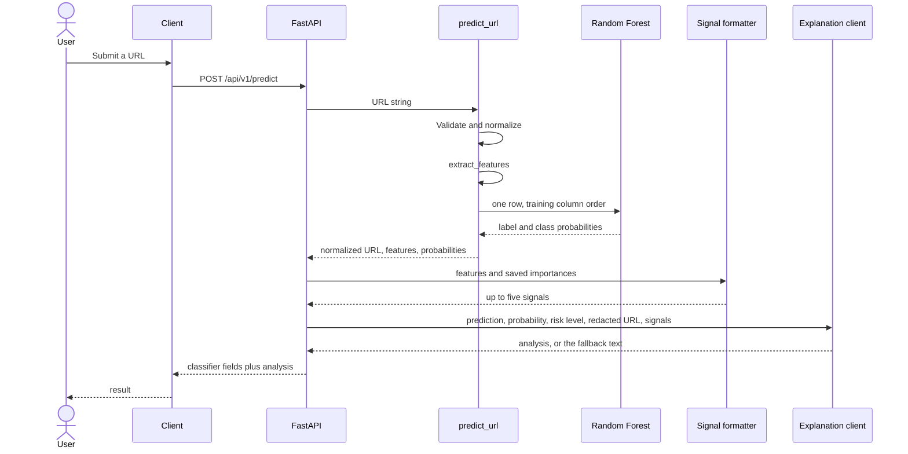
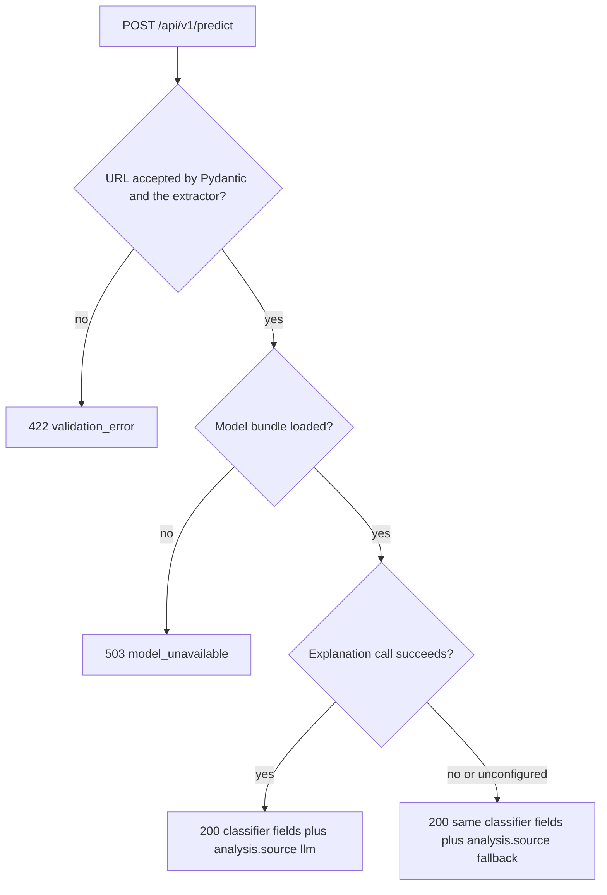

# IntelliShield — Request Workflow

This is the path from the Next.js page through the FastAPI service. The Random Forest assigns the label. A language model may explain that label afterward and cannot replace it.

## Main path

```text
User
 ↓
Next.js UI          frontend/ on port 3000
 ↓
FastAPI API         POST /api/v1/predict
 ↓
URL validation/normalization
 ↓
Feature extraction  (ml/src/feature_extractor.py, same function as training)
 ↓
Random Forest inference
 ↓
Prediction + probability
 ↓
Threat signal extraction
 ↓
LLM explanation        (or a fallback built from the same facts)
 ↓
Combined response
```

Normalization and feature extraction are one call. `predict_url` in `ml/src/predict.py` rejects a malformed URL before it loads a row into the forest, and it returns the normalized URL plus the 15 features. The API does not parse the URL a second way and does not recompute those formulas.



The server does not open a connection to the submitted host. Startup loads the joblib bundle by scoring the fixed string `https://example.com/` locally. That string is not fetched.

## Step by step

### 1. Client

The page in `frontend/app/page.tsx` submits `{"url": "<text>"}` to `NEXT_PUBLIC_API_BASE_URL/api/v1/predict`. It shows a loading state and does not keep a previous verdict on screen during that request. Pydantic requires a string, trims it, and rejects an empty value or a value longer than 16384 characters. The error body does not repeat the submitted text. The page displays that message and does not invent a label.

### 2. FastAPI

`POST /api/v1/predict` assigns a request id header and writes a log line with the method, path, and status. The log line does not include the URL. `GET /health` reports whether warmup loaded the bundle. `GET /docs` serves the generated OpenAPI UI.

If the bundle is missing, the route returns 503 and does not score.

### 3. URL validation and normalization

Handled inside `extract_features`, which training also uses. The scheme must be `http` or `https`. The hostname is lowercased and IDNA-encoded. The fragment is removed. Userinfo and an explicit port are kept. A schemeless string such as `example.com` is a 422, because the API does not invent `https` and flip `uses_https`.

Shell metacharacters in the path stay inside the URL string. They are not passed to a shell.

### 4. Feature extraction and inference

`predict_url` builds one dataframe row in the order stored in `feature_config.json` and calls `predict` and `predict_proba`. The model label `legitimate` becomes the API prediction `safe`. The model label `phishing` stays `phishing`.

`probability` is the probability of the label in the response. `risk_level` is `low`, `medium`, or `high` from the phishing-class probability, using the buckets in `API_SPECIFICATION.md`.

### 5. Threat signals

`feature_service.build_signals` does not extract features again. It keeps active indicators (IP host, `@`, known shortener, suspicious-keyword token, or HTTP) and fills the list up to five entries from the impurity importances saved at training time. Each summary describes the number that was measured.

### 6. Explanation

`llm_service.explain` runs only after the label, probability, risk level, and signals exist. It sends that closed set, plus the normalized URL with userinfo and query values replaced by `REDACTED`. It does not send the API key, the raw query string, or the rest of the feature row.

The chat call uses `OPENAI_BASE_URL`, `OPENAI_MODEL`, and `OPENAI_API_KEY`, with a timeout of `LLM_TIMEOUT_SECONDS` (default 20). One attempt. The response must be a JSON object with `summary`, `reasoning`, `risk_factors`, and `recommendations`. Any other field, including a label, is discarded.

If the key, base URL, or model name is missing, or the call times out, returns an HTTP error, or returns JSON that fails that schema, `analysis.source` is `fallback`. The fallback sentences are built from the classifier label and the signal summaries. `prediction`, `probability`, `risk_level`, `features`, and `signals` stay the values computed before the call.

### 7. Response

One JSON object, specified in `API_SPECIFICATION.md`. `prediction` is the classifier label. `analysis` is the explanation of that label.

## Failure branches



| Condition | HTTP | Result |
|-----------|------|--------|
| Blank URL, bad scheme, missing host, IDNA failure, or length over 16384 | 422 | Error object. No score. |
| Model file missing, unreadable, or feature names do not match the extractor | 503 | `The detection model is not loaded.` |
| Unexpected exception before a classifier result exists | 500 | Generic message. The exception is logged without the URL added to the log line. |
| Language model missing, timed out, or invalid | 200 | Classifier result unchanged. `analysis.source` is `fallback`. |

## Not on this path

- A second classification by the language model.
- Page fetch, DNS resolution, or redirect following. The explanation client calls only the configured chat endpoint.
- Storing the raw URL. A successful score writes a SQLite row whose URL has userinfo and query values removed. The history routes read that row and do not score again.
